# VeraTrace

**A privacy-first digital evidence preservation and cross-platform harassment pattern analysis engine.**

VeraTrace enables individuals, legal advocates, and investigators to catalog, cryptographically seal, correlate, and organize electronic evidence scattered across communication platforms into an immutable, court-ready forensic dossier.

All processing, hashing, and storage occur **entirely on the user's device**. Nothing is uploaded to external cloud servers, and original files are never altered.

> 🌐 **Live Production Application:** [https://veratrace-app.vercel.app](https://veratrace-app.vercel.app)

---

## Table of Contents

- [Problem Statement](#problem-statement)
- [Our Solution](#our-solution)
- [Key Features](#key-features)
- [How It Works](#how-it-works)
- [Technology Stack](#technology-stack)
- [System Architecture](#system-architecture)
- [Application Screenshots](#application-screenshots)
- [Getting Started](#getting-started)
- [Demo Walkthrough (`VT-DEMO-2026`)](#demo-walkthrough-vt-demo-2026)
- [Testing & Production Build](#testing--production-build)
- [Project Structure](#project-structure)
- [Security, Privacy, and Limitations](#security-privacy-and-limitations)
- [Legal Considerations & Section 63 BSA](#legal-considerations--section-63-bsa)
- [Future Scope](#future-scope)
- [Contributors & Licence](#contributors--licence)

---

## Problem Statement

Digital harassment, stalking, and cyberbullying rarely occur on a single platform. Perpetrators deliberately disperse unwanted communications across multiple channels—Instagram DMs, WhatsApp chats, SMS text messages, emails, VoIP calls, and secondary burner accounts—to evade blocks and obscure their identity.

Victims and advocates face significant challenges:
1. **Scattered Artifacts:** Screenshots and chat exports sit disorganized across camera rolls, folders, and messaging apps.
2. **Volatile & Fragile Evidence:** Messages are frequently unsent, profiles deleted, and file metadata corrupted during routine transfers.
3. **Absence of Chain-of-Custody:** Screenshots without verifiable cryptographic digests are easily dismissed as manipulated or fabricated.
4. **Strict Legal Standards:** Statutory frameworks, such as **Section 63 of the Bharatiya Sakshya Adhiniyam, 2023 (BSA)** in India, require electronic records submitted to courts or police to be certified with verifiable technical particulars, device custody declarations, and cryptographic hashes that ordinary users cannot easily assemble.

---

## Our Solution

VeraTrace provides a structured, trauma-informed digital intake system designed to transform scattered digital artifacts into organized forensic evidence without sacrificing personal privacy:

- **100% Client-Side Immutability:** Files are ingested and hashed via the browser's Web Crypto API using SHA-256 before being stored in private local browser storage (IndexedDB). Files never leave the machine.
- **Cross-Platform Incident Correlation:** Automatically correlates contact events across WhatsApp, Instagram, SMS, Email, and calls by identifying shared handles, phone numbers, recurring phrases, and contact resumption after blocking.
- **Early-Risk Pattern Evaluation:** Evaluates behavioral cadence, off-hours contact (10 PM – 6 AM), and escalating velocity to provide early risk visibility.
- **Visual Forensic Intelligence:** Displays multi-entity relationships through an interactive Relationship Graph connecting platforms, accounts, shared clues, incidents, and files.
- **Formal Dossier Generation:** Exports comprehensive PDF dossiers, structured ZIP archives containing raw files with cryptographic checksums, and draft Section 63 BSA statutory certificates.
- **Trauma-Informed Safety:** Features an omnipresent Quick Exit button and global `Escape` key shortcut that instantly routes to a neutral page without destroying local records.

---

## Key Features

### 1. Evidence Studio & Cryptographic Hashing
- Drag-and-drop intake for images, PDFs, text chat exports, and audio recordings.
- Streaming SHA-256 calculation computed client-side using the native `crypto.subtle` Web Crypto API.
- Binary payloads securely persisted in a browser-isolated IndexedDB vault (`vaultStorage.ts`).
- Inline visual specimen preview for image captures with investigative metadata notes.

### 2. Cross-Platform Harassment Pattern Analysis
- Correlates evidence and timeline incidents across disparate communication channels (WhatsApp, Instagram, Email, SMS, Phone/Voicemail, and Other).
- Detects shared handles, phone numbers, URLs, and repeated phrases across accounts.
- Identifies **contact resumed after blocking**, highlighting deliberate block evasion.
- Computes behavioral indicators: multi-platform spread, contact velocity, and off-hours communication patterns.

### 3. Interactive Relationship Graph
- SVG-based network graph visualizing connections between platforms, sender accounts, shared clues, timeline incidents, and evidence files.
- Interactive category filtering to isolate specific entity types.
- Highlights evidence-linked hubs to expose persistent multi-channel actors.

### 4. Forensic Timeline with Uncertainty Handling
- Chronological ordering of events with clear demarcation between confirmed dates and approximate recollections.
- Direct linking between timeline events and sealed evidence files.
- Refuses to invent timestamps: events with approximate times are explicitly badged as `Date uncertain` to protect legal credibility.

### 5. Evidence Dossier & Export Engine
- **Printable Legal Dossier:** High-density, professional document layout with case particulars, verification statistics, forensic timeline, and cryptographic ledger.
- **PDF Compilation (`exportDossierPdf`):** Exports a downloadable, standardized PDF dossier with Section 63 BSA certificate drafts.
- **Evidence ZIP Vault (`exportEvidenceZip`):** Packages all original preserved binary evidence files alongside a signed JSON manifest and statutory text certificates.
- **Direct Cybercrime Handoff:** Provides verified links to India's National Cyber Crime Reporting Portal (`cybercrime.gov.in`) and the National Cybercrime Helpline (`1930`).

### 6. Standalone Integrity Verifier
- Dedicated `/verify` route allowing anyone to check two files side-by-side or re-verify an existing file against its recorded SHA-256 hash.
- Clear visual match/mismatch indicators with eight-character hash block formatting for human readability.

### 7. Global Quick Exit & Safety Controls
- Fixed Quick Exit button in header and mobile tab bar.
- Global `Escape` key capture phase listener active across all views and open dialogs.
- Leaves immediately for a neutral website (`weather.com`) without showing confirmation prompts or deleting preserved records.

---

## How It Works

VeraTrace follows a 5-step forensic preservation workflow:

```
┌────────────────┐     ┌───────────────┐     ┌────────────────┐     ┌───────────────┐     ┌────────────────┐
│  1. PRESERVE   │ ──► │  2. CONNECT   │ ──► │   3. ANALYSE   │ ──► │   4. VERIFY   │ ──► │  5. DOCUMENT   │
│                │     │               │     │                │     │               │     │                │
│ Drop files     │     │ Link incident │     │ Run cross-     │     │ Re-compute    │     │ Generate PDF   │
│ Compute SHA256 │     │ Add handles   │     │ platform       │     │ SHA-256 hash  │     │ Export ZIP     │
│ Store in vault │     │ Tag platforms │     │ pattern engine │     │ Check match   │     │ BSA 63 draft   │
└────────────────┘     └───────────────┘     └────────────────┘     └───────────────┘     └────────────────┘
```

1. **Preserve:** Drop screenshots, chat logs, or documents. The engine calculates an exact SHA-256 digest and seals the artifact in IndexedDB.
2. **Connect:** Associate the artifact with an incident, specify the platform, note sender identifiers, and record whether contact occurred after a block.
3. **Analyse:** The pattern analysis engine scans for cross-channel links, aggregates account handles, computes risk indicators, and generates the relationship graph.
4. **Verify:** Check recorded hashes at any time against fresh files to prove byte-for-byte integrity since intake.
5. **Document:** Export a court-ready evidence dossier (PDF), downloadable ZIP vault, and pre-filled Section 63 BSA certificate draft.

---

## Technology Stack

| Layer | Technologies |
| :--- | :--- |
| **Framework & Runtime** | [React 18](https://react.dev/), [Vite 6](https://vitejs.dev/), [React Router v7](https://reactrouter.com/) |
| **Languages** | JavaScript (ESM), TypeScript |
| **Styling & Tokens** | [Tailwind CSS v4](https://tailwindcss.com/) (`@tailwindcss/vite`, CSS `@theme` tokens in `src/styles/app.css`) |
| **UI Primitives** | [Radix UI](https://www.radix-ui.com/) (`Dialog`, `Tooltip`, `Tabs`, `DropdownMenu`), [Lucide React](https://lucide.dev/) |
| **Typography** | `@fontsource-variable` (Fraunces for editorial display, Inter for UI, JetBrains Mono for hashes and IDs) |
| **Motion** | [Motion](https://motion.dev/) (Framer Motion v14) with global `reducedMotion="user"` accessibility support |
| **Cryptography** | Web Crypto API (`crypto.subtle`), SHA-256 streaming, [canonicalize](https://github.com/cyberphone/canonicalize) (RFC 8785) |
| **Packaging & Export** | [JSZip](https://stuk.github.io/jszip/), [pdfkit](https://pdfkit.org/), Canvas 2D image rendering |
| **Client Storage** | IndexedDB (`vaultStorage.ts`), HTML5 `localStorage` fallback |
| **Testing** | [Vitest 5](https://vitest.dev/) (23 test suites, 281 passing tests) |

---

## System Architecture

```mermaid
flowchart TD
    subgraph ClientUI ["Browser Application Layer"]
        Shell["AppShell & Quick Exit"]
        Dash["Dashboard & Case Manager"]
        Studio["Evidence Studio & Dropzone"]
        Analysis["Cross-Platform Analysis & Graph"]
        DossierView["Dossier & Statutory Certificate"]
        VerifyView["Standalone Verifier"]
    end

    subgraph StateManagement ["Application State & React Context"]
        Store["VeraStore Provider"]
        Toast["Toast Notification Provider"]
        Router["React Router v7 Navigation"]
    end

    subgraph CoreEngine ["Forensic & Analysis Services"]
        CorrService["Incident Correlation Engine"]
        RiskService["Early-Risk Pattern Service"]
        CaseStore["Case & Dossier Store"]
        TimelineService["Forensic Timeline Service"]
    end

    subgraph StorageLayer ["Client-Side Security & Storage"]
        WebCrypto["Web Crypto API (SHA-256)"]
        VaultDB["IndexedDB Vault (Binary Blobs)"]
        LocalStore["LocalStorage (Metadata & Events)"]
        Packager["ZIP & PDF Packaging Engine"]
    end

    subgraph ArtifactOutputs ["Generated Deliverables"]
        PDF["Compiled PDF Dossier"]
        ZIP["Evidence Vault ZIP + Signed Manifest"]
        BSACert["Section 63 BSA Certificate Draft"]
    end

    ClientUI --> StateManagement
    StateManagement --> CoreEngine
    CoreEngine --> StorageLayer
    StorageLayer --> ArtifactOutputs
```



---

## Application Screenshots

> *Note: Below are placeholders for application walkthrough screenshots. To add genuine screenshots, place image files in `public/screenshots/` and update these links.*

| View | Preview |
| :--- | :--- |
| **Dashboard**<br>Case overview with metrics, search, and one-click demo loader | <br>*(Placeholder — capture from `http://localhost:5173/dashboard`)* |
| **Cross-Platform Analysis**<br>Interactive Relationship Graph and early-risk escalation assessment | <br>*(Placeholder — capture from `http://localhost:5173/case/VT-DEMO-2026/analysis`)* |
| **Evidence Studio**<br>Client-side drag-and-drop dropzone, SHA-256 seal marks, and artifact viewer | <br>*(Placeholder — capture from `http://localhost:5173/case/VT-DEMO-2026/evidence`)* |
| **Evidence Dossier**<br>Printable ledger, forensic timeline, and Section 63 BSA statutory certificate draft | <br>*(Placeholder — capture from `http://localhost:5173/case/VT-DEMO-2026/dossier`)* |

---

## Getting Started

### Prerequisites
- **Node.js:** v18.0.0 or higher (v20+ recommended)
- **npm:** v9.0.0 or higher

### Installation

1. Clone the repository:
   ```bash
   git clone https://github.com/fatimasafwa30/NITK-reHERsion.git
   cd NITK-reHERsion
   ```

2. Install dependencies:
   ```bash
   npm install
   ```

3. Start the Vite development server:
   ```bash
   npm run dev
   ```

4. Open your browser and navigate to:
   ```text
   http://localhost:5173/
   ```

---

## Demo Walkthrough (`VT-DEMO-2026`)

VeraTrace comes pre-configured with a comprehensive, realistic demo case: **Case VT-DEMO-2026 — Cross-Platform Harassment Investigation**.

> **Disclosure:** All individuals, phone numbers, email addresses, social media accounts, chat exports, and images in `VT-DEMO-2026` are **entirely fictional demonstration artifacts** generated for testing and demonstration purposes.

### Exploring the Demo:

1. **Load the Demo:** Open the Dashboard and click **"Load Demo Case"** in the top header.
2. **Review Case Overview (`/case/VT-DEMO-2026`):**
   - Inspect the **Core Analysis & Forensic Intelligence** preview banner.
   - Observe the 4-step workflow journey navigation bar.
3. **Inspect the Evidence Studio (`/case/VT-DEMO-2026/evidence`):**
   - View 5 pre-loaded sealed evidence files across WhatsApp, Instagram, SMS, and HR records.
   - Click any item to inspect its SHA-256 hash, MIME type, preview artifact thumbnail, and investigative notes.
4. **Analyze Patterns (`/case/VT-DEMO-2026/analysis`):**
   - Interact with the **Cross-Platform Relationship Graph**: click entity tags (Platforms, Accounts, Clues, Evidence Files, Incidents) to filter connected nodes.
   - Review the **Early-Risk Assessment**: observe detected multi-channel spread, off-hours contact, and the explicitly flagged **contact resumed after block** event.
5. **Export the Dossier (`/case/VT-DEMO-2026/dossier`):**
   - Click **"Export PDF"** to compile the legal dossier.
   - Click **"Download ZIP"** to bundle all original files, checksums, and the Section 63 BSA draft.
   - Review Section 06 (BSA 2023 Statutory Certificate preparation) and Section 07 (Cybercrime portal submission guide).

---

## Testing & Production Build

### Running the Test Suite
The repository includes unit, service, forensic, and UI integration test suites executed with Vitest:

```bash
npm test
```
*Current test suite status: 23 test files passed, 281 tests passed (0 failures).*

### Building for Production
To generate the optimized production build:

```bash
npm run build
```
Compiled assets are output to the `dist/` directory.

### Previewing the Production Build
To preview the compiled production build locally:

```bash
npm run preview
```
The preview server will launch at `http://localhost:5176/`.

---

## Project Structure

```text
NITK-reHERsion/
├── public/                       # Static public assets
│   ├── demo-assets/              # Simulated demo screenshots, reports, and manifests
│   └── seal.svg                  # SVG seal mark
├── src/
│   ├── components/               # Reusable UI and domain components
│   │   ├── ui/                   # Design system primitives (Button, Dialog, Field, StatusMark, Tooltip)
│   │   ├── AddEventDialog.jsx    # Timeline event creation modal with cross-platform fields
│   │   ├── AppShell.jsx          # Desktop header, contextual navigation, and mobile tab bar
│   │   ├── Dropzone.jsx          # Drag-and-drop file intake with streaming SHA-256 hashing
│   │   ├── EvidenceSheet.jsx     # Archival evidence card with thumbnail preview
│   │   ├── PatternAnalysis.jsx   # Harassment pattern analysis and risk findings summary
│   │   ├── QuickExit.jsx         # Safety quick-exit button and global Escape handler
│   │   ├── RelationshipGraph.jsx # Interactive SVG network graph
│   │   └── Timeline.jsx          # Chronological timeline and forensic tables
│   ├── data/                     # Mock data and demo case seeders
│   │   ├── demoAssetPayloads.js  # Base64 file payloads for offline demonstration
│   │   └── demoCaseData.js       # Complete VT-DEMO-2026 scenario and seeding logic
│   ├── lib/                      # Forensics, hashing, formatters, and utilities
│   │   ├── forensics/            # Content sniffers, metadata extractors, and packagers
│   │   ├── format.js             # Date, timestamp, hash block, and file size formatters
│   │   └── hash.js               # Web Crypto SHA-256 file hashing utilities
│   ├── motion/                   # Motion tokens, transitions, and accessible animations
│   ├── pages/                    # Main application routes
│   │   ├── CaseOverview.jsx      # Individual case dashboard and timeline view
│   │   ├── CrossPlatformAnalysis.jsx # Dedicated pattern correlation and risk analysis page
│   │   ├── Dashboard.jsx         # Case catalog, metrics, search, and demo loader
│   │   ├── Dossier.jsx           # Printable dossier, PDF/ZIP exporters, and BSA certificate
│   │   ├── EvidenceStudio.jsx    # Evidence file management and dropzone
│   │   ├── Landing.jsx           # Introductory landing page
│   │   └── Verifier.jsx          # Side-by-side SHA-256 hash comparison tool
│   ├── services/                 # Core business and forensic logic
│   │   ├── caseStore.js          # Case persistence, PDF compilation, and ZIP packaging
│   │   ├── evidenceService.ts    # Evidence CRUD, verification, and file processing
│   │   ├── incidentCorrelationService.js # Cross-platform clustering and graph builder
│   │   ├── patternAnalysisService.js # Cadence, velocity, and escalation detector
│   │   ├── riskAnalysisService.js    # Factual risk score and escalation indicator evaluator
│   │   ├── timelineService.ts    # Timeline event storage and event ordering
│   │   └── vaultStorage.ts       # IndexedDB binary file vault storage
│   ├── store/                    # Context providers
│   │   ├── ToastProvider.jsx     # Non-intrusive toast notifications
│   │   └── VeraStore.jsx         # Primary application state provider and live service sync
│   └── styles/
│       └── app.css               # Tailwind CSS v4 design tokens and print stylesheets
└── tests/                        # Vitest test suite
    └── unit/                     # Unit and integration tests for forensics, services, and UI
```

---

## Security, Privacy, and Limitations

### Privacy & Storage Architecture
- **Zero Cloud Uploads:** Files dragged into VeraTrace are hashed and persisted in the local browser via IndexedDB. No remote servers receive original evidence files.
- **Quota & Session Sensitivity:** Private/incognito browsing windows may wipe IndexedDB upon closure. Users are encouraged to export their dossier (PDF/ZIP) to safe external media.

### What SHA-256 Proves (and What It Does Not)
- **Integrity Verification:** A matching SHA-256 checksum proves that the file currently stored on disk is byte-for-byte identical to the file initially sealed in VeraTrace.
- **Authenticity Limits:** A cryptographic hash does **not** prove who authored the message, whether a screenshot was staged or manipulated before intake, or the true real-world occurrence of the depicted events. VeraTrace makes this distinction explicit throughout the interface.

---

## Legal Considerations & Section 63 BSA

### Evidentiary Disclaimer
VeraTrace is an evidence organization and integrity preservation tool. **It does not provide legal advice, and using VeraTrace does not guarantee that evidence will be deemed admissible in court.** Admissibility is determined by judges, prosecutors, police officers, and forensic examiners in accordance with applicable rules of evidence.

### Bharatiya Sakshya Adhiniyam, 2023 (Section 63)
In India, electronic evidence produced in court or police proceedings must be accompanied by a statutory certificate under Section 63 of the Bharatiya Sakshya Adhiniyam, 2023 (formerly Section 65B of the Indian Evidence Act, 1872).

VeraTrace assists users by generating a **draft Section 63 BSA Certificate template**:
- **Pre-filled Technical Facts:** Pre-fills software engine version (`VeraTrace Intake Engine v0.1.0-mvp`), NIST-standard SHA-256 hash digests, timestamps of intake, and local client vault references.
- **Physical Certification Required:** The user or certifying authority must physically print the document, fill in hardware-specific particulars (device make, model, serial number/IMEI, and operating system), and sign the statutory declaration confirming lawful custody of the device.
- **No Automatic Compliance:** A generated template is **not automatically legally compliant** until completed, signed, and submitted by an authorized person under the statutory guidelines.

---

## Future Scope

1. **Native Header Parsers:** Direct client-side parsing of raw `.eml` email headers, WhatsApp exported chat `.txt` files, and telecommunications call data records (CDRs).
2. **Hardware Key Attestation:** Optional cryptographic signing using WebAuthn (YubiKey / FIDO2) to bind file intake to physical hardware tokens.
3. **End-to-End Encrypted Advocate Handoff:** Client-side encrypted peer-to-peer sharing with verified legal aid organizations and cybercrime crisis counselors.
4. **Progressive Web App (PWA):** Full offline capability with service worker caching for low-connectivity environments.

---

## Contributors & Licence

### Project Authors
Developed for the **NITK reHERsion Hackathon**:
- **Fatima Safwa** ([@fatimasafwa30](https://github.com/fatimasafwa30))
- **Hania** ([@haniyagawai5](https://github.com/haniyagawai5))
- **Waibha** ([@suwaibhafathima](https://github.com/suwaibhafathima))

### Licence
Private Hackathon Repository. All rights reserved by the original authors unless explicitly licensed otherwise.
